  

  
  
  
  

 

## One team for the whole product.

We design, build and run web apps, mobile apps and AI products end to end — no hand-offs between agencies. Engineering happens in **Ahmedabad, India**; sales and support run from **Brampton, Canada**.

<table>
  <tr>
    <td width="25%" valign="top">
      <h3>🌐 Web</h3>
      Marketing sites, SaaS platforms, dashboards, booking and e-commerce.  
      <code>Next.js</code> <code>React</code>
    </td>
    <td width="25%" valign="top">
      <h3>⚙️ Backend</h3>
      APIs, databases, payments and third-party integrations.  
      <code>Node.js</code> <code>Spring Boot</code>
    </td>
    <td width="25%" valign="top">
      <h3>📱 Mobile</h3>
      iOS and Android — cross-platform, native or PWA.  
      <code>React Native</code> <code>Flutter</code>
    </td>
    <td width="25%" valign="top">
      <h3>🤖 AI</h3>
      RAG over documents, chatbots, voice agents and workflow automation.  
      <code>LangChain</code> <code>OpenAI</code>
    </td>
  </tr>
</table>

## Products we built and run ourselves.

| Product | What it does | Platform | Status |
| :-- | :-- | :-- | :-- |
| [**AI Interview Agent**](https://www.thitainfo.com/products/ai-interview-agent) | AI-run candidate interviews | Web · SaaS | 🟢 Live |
| [**AI URL to Video**](https://www.thitainfo.com/products/url-to-video) | Turn any link into a video | Web | 🟢 Live |
| [**CalculatorHub**](https://www.thitainfo.com/projects/calculatorhub) | Everyday calculators in one place | PWA | 🟢 Live |
| **PocketBook** | Our Android app, coming to Google Play | Android · React Native | 🟡 In review |
| **AI Assistant** | Floating AI bubble that works in any app | Android · Native | 🟡 In review |
| [**Expense Tracker**](https://www.thitainfo.com/expense-tracker) | Simple spending tracker | Android | ⚪ Coming soon |

## Tech we ship with

  
   
  

  

## Ways to work with us

- **MVP sprint** — go from idea to a shipped first version, fast.
- **Dedicated team** — our engineers working as part of yours.
- **Product partnership** — we build it, launch it and keep it running with you.

Every engagement starts with a free intro call.

 

  <a href="https://www.thitainfo.com"><b>Tell us what you need built →</b></a>

